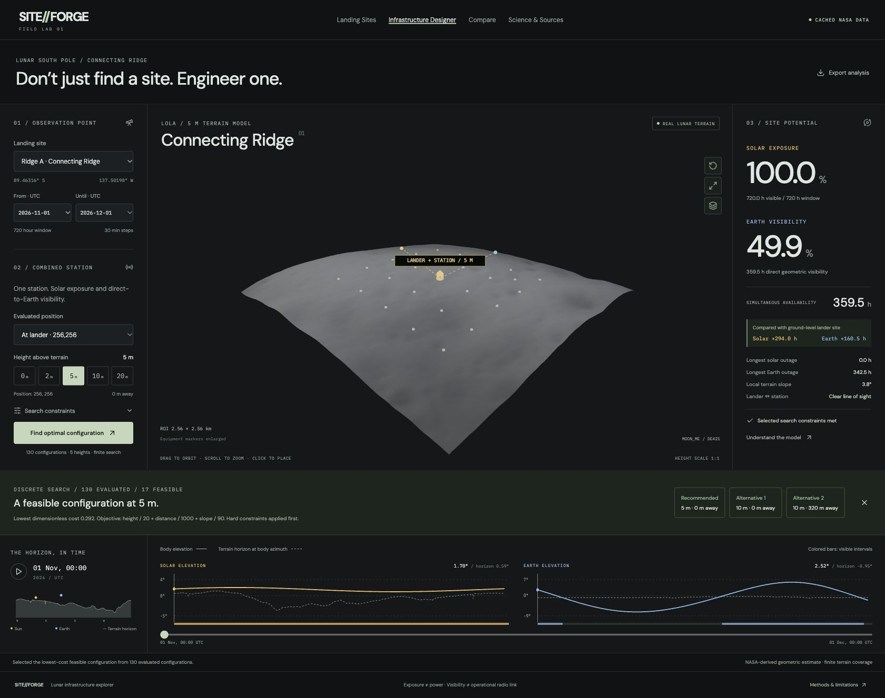

# Browser verification — 2026-11-14

Tested in the user's existing Brave browser, first on the development server and then on the built static application. This report covers observed behavior; it does not assert scientific certification or universal browser compatibility.

## Observed flows

| Flow | Observed result |
|---|---|
| Initial real-data load | Ridge A November baseline: 426 h Sun, 199 h Earth, 54 h simultaneous |
| Raise station to 10 m | 720 h Sun, 382 h Earth and simultaneous; metrics and horizon update |
| Strict search | 130 evaluated, 0 feasible with maximum outage 240 h; explicit infeasible message |
| Feasible search | 17 feasible at 360 h maximum outage; 5 m co-located station recommended, cost 0.292 |
| Change site and dates | Ridge B November 10–20: 46.5 h Sun, 81.5 h Earth, 45.5 h simultaneous over 240 h |
| Timeline endpoint | Keyboard End selects November 20 00:00, curves and body angles update without extra duration |
| Compare | Both sites and independent date ranges render; per-site cursor timestamps identify differing dates |
| Terrain selection | Clicking an evaluated point selects cell (320,384), shows 725 m distance and recalculated metrics |
| Camera | Top-view, reset and wireframe controls change the real terrain rendering |
| Methodology | Real source links, regional coverage, model limits, exact provenance and cached-data limits exposed |
| Responsive | 1024×768 notebook/tablet layout inspected; 390×844 mobile width had documentWidth=viewportWidth=390 |

A render cleanup issue from DOM labels inside the 3D scene was found while switching views. Labels were replaced by scene sprites, and the view-change flow was repeated without new console errors.

## Automated evidence

- 29 Python tests passed (geometry, temporal boundaries, input failures, API, NASA raw parsing, regional data/checksum and height monotonicity).
- 6 JavaScript tests passed, including every exported metric over 130 configurations and eight optimizer comparisons against Python on the same NASA-derived search space.
- Strict TypeScript and production Vite build passed.
- Production scientific snapshot SHA-256: `0bbc60591c01d55a86dea65640230b95a08f7de2a1a921a280f5691bf6af8584`.
- Product fonts and scientific data are bundled locally. Only source citations navigate to external sites; the app does not call NASA APIs at runtime.

## Limits

The static JSON scientific cache is approximately 43 MB uncompressed. A normal static host should enable transfer compression. The 3D library bundle is approximately 339 KB gzip; Vite reports a bundle-size advisory, not a failed build. Browser coverage is Brave desktop and emulated viewport sizes, not every device/GPU. A fallback message and accessible station controls remain available if 3D rendering fails.

Browser verification used the local `dist/` build. GitHub is the distribution target for this version.

## Final static-package check

The production `dist` build was served by Python's static HTTP server at port 4173, with no FastAPI process. The 130-configuration search returned 17 feasible options and selected 5 m. Compare → Infrastructure Designer navigation completed with an empty error/warning console log. The export opened Brave's native Save dialog; after saving, the 672,346-byte JSON was read back and confirmed 720 h Sun, 359.5 h Earth, height 5 m, 130 evaluated / 17 feasible. The initial automation wait timed out while that Save dialog awaited confirmation; the product download itself succeeded.

