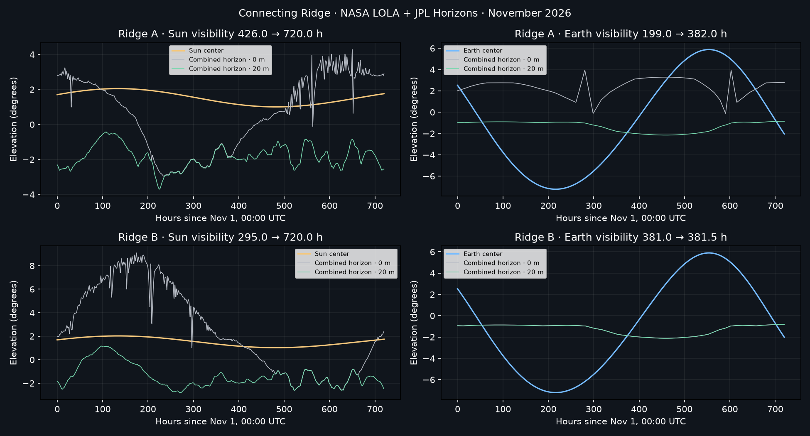

# Real-data scientific validation

Status: **Reproducible multi-resolution terrain experiment completed. Not a certified mission validation.**

## Data and coordinates

- **Ridge A**: -89.463157757° latitude, -137.501984908° east longitude; elevation 1944.767 m; crop cell (256, 256).
- **Ridge B**: -89.485521149° latitude, -137.610816634° east longitude; elevation 1921.306 m; crop cell (160, 352).

The source is NASA LOLA Site01 Connecting Ridge, `Site01_final_adj_5mpp_surf.tif`, 3200 × 3200 pixels at 5 m. The retained ROI is source window [1344,1344,512,512], a 2.56 km square. Pixel centers are transformed using the GeoTIFF south-polar stereographic CRS. The sphere radius is 1,737,400 m. Heights are treated as radial elevations above that sphere; see LOLA RDR/GDR data specification. Source checksum, CRS, transform, acquisition date and source tags are retained in `data/terrain-metadata.json`.

Horizons requested separate Sun (10) and Earth (399) observer tables at each point, airless, quantity 4, 30-minute sampling, **2026-11-01 00:00 to 2026-12-01 00:00 UTC** (720 h). Raw responses and exact queries are retained. Returned center frame is `MEAN_ME (high precision)`, the lunar mean-Earth frame described by the Horizons manual as DE421, matching the DEM; returned center radii are 1737.4 km. East-positive longitudes and altitude in km are used. Underlying dynamical ephemeris is DE441; it does not change the documented body-fixed coordinate convention.

## Computed experiment

| Point | Height (m) | Sun (h) | Earth (h) | Both (h) | Longest solar outage (h) | Longest Earth outage (h) | Longest simultaneous outage (h) |
|---|---:|---:|---:|---:|---:|---:|---:|
| ridge-a | 0 | 426.0 | 199.0 | 54.0 | 87.0 | 458.0 | 465.0 |
| ridge-a | 2 | 564.0 | 291.5 | 173.0 | 66.0 | 391.0 | 391.0 |
| ridge-a | 5 | 720.0 | 359.5 | 359.5 | 0.0 | 342.5 | 342.5 |
| ridge-a | 10 | 720.0 | 382.0 | 382.0 | 0.0 | 320.0 | 320.0 |
| ridge-a | 20 | 720.0 | 382.0 | 382.0 | 0.0 | 320.0 | 320.0 |
| ridge-b | 0 | 295.0 | 381.0 | 291.5 | 296.5 | 321.0 | 410.5 |
| ridge-b | 2 | 412.0 | 381.0 | 346.0 | 267.5 | 321.0 | 346.0 |
| ridge-b | 5 | 490.5 | 381.0 | 366.5 | 169.0 | 321.0 | 335.5 |
| ridge-b | 10 | 632.0 | 381.0 | 381.0 | 88.0 | 321.0 | 321.0 |
| ridge-b | 20 | 720.0 | 381.5 | 381.5 | 0.0 | 320.5 | 320.5 |



## Method

Terrain cell centers are mapped to spherical ECEF positions using radius plus elevation. Each observer's north/east/up basis gives obstacle elevation and true geographic azimuth. The maximum cell-center elevation in each 1° sector across both local and regional datasets defines the combined terrain horizon. Periodic interpolation samples that horizon along each body's azimuth. Visibility is center elevation strictly greater than horizon. Increasing infrastructure height changes the observer position and recomputes the horizon. Time integration uses left-endpoint states on [first,last), avoiding an extra interval after the final sample.

## Limitations

- Regional NASA LOLA terrain extends the horizon to 150 km. Original 80 m cell centers are retained to 30 km; the highest real cell (with its actual coordinates) in each 4×4 block is retained from 30 to 150 km. The 5 m local crop remains the near field. Features beyond 150 km and within-cell peaks can still be missed; coarse-block peak placement can distort angular coverage. See data/regional-metadata.json for provenance.
- NASA's gridded terrain includes substantial interpolation. Cell size is not measurement accuracy; no DEM uncertainty ensemble was propagated.
- Cell-center angular sectors can miss narrow obstacles; no convergence guarantee is claimed. Local-only angular sensitivity at Ridge A, 0 m: 180/360/720 bins produce 411/426/443.5 solar hours and 189/199/209 Earth hours. These differences must not be interpreted as numerical precision of 0.5 h.
- Body centers only; no solar disk fraction, eclipse filtering, electrical power, Fresnel clearance or radio link budget.
- Heights reuse their ground-position observer ephemeris: at 20 m the neglected translation parallax is below 0.000004° for Earth at distances above 300,000 km, and smaller for Sun. Visibility close to a threshold remains sensitive.
- Half-hour sampling can miss or mis-time shorter events. The experiment is a conditional geometric estimate, not a certified landing recommendation.

## Reproduce

```sh
.venv/bin/python scripts/prepare_data.py
.venv/bin/python scripts/acquire_ephemeris.py  # online only when cache missing
.venv/bin/python scripts/validate_real_data.py # offline
.venv/bin/python -m unittest discover -s tests -v
```

## Sources

- [NASA LOLA product and uncertainty description](https://pgda.gsfc.nasa.gov/products/78)
- [Official dataset README](https://pgda.gsfc.nasa.gov/data/LOLA_5mpp/README)
- [Horizons observer conventions and lunar reference frame](https://ssd.jpl.nasa.gov/horizons/manual.html)
- [LOLA RDR/GDR specification](https://science.nasa.gov/wp-content/uploads/2024/01/lola-rdrsis.pdf)
- [Barker et al. source paper](https://doi.org/10.1016/j.pss.2020.105119)

## Regional source and discovery

The second real NASA dataset is [LOLA South Pole 20 m/pixel DEM and Data Products](https://pgda.gsfc.nasa.gov/products/90), using its `LDEM_80S_80MPP_ADJ.TIF` 80 m product. 1,103,352 retained real source samples provide regional obstacles. The 150 km coverage and multi-resolution reduction are engineering approximations.

At Ridge A, a 10 m observer reaches 382 h of Earth-center visibility; raising it to 20 m yields 382 h. Distant terrain caps that benefit. The local-only 20 m result was 480 h, overestimating it by 98 h. This plateau is an actual computed result, not an imposed UI effect.

## Initial local-only diagnostic

The first local-only results were retained in `docs/LOCAL_ONLY_EXPERIMENT.md`. The values above supersede them for the demo; far-field terrain changes absolute visibility and may cap height benefits.

## Published illumination context, not a direct benchmark

NASA PGDA product 78 describes areas of Site01 with average illumination above 70% at 1 m over 2024-01-01 to 2026-01-01, and improved illumination at 5 m. That area-based, two-year result uses different positions, heights and dates from this point-specific November 2026 experiment. It supports investigating height sensitivity, but is not an independent numerical validation of our reported hours. A matched coordinate/time/method comparison remains future work.
